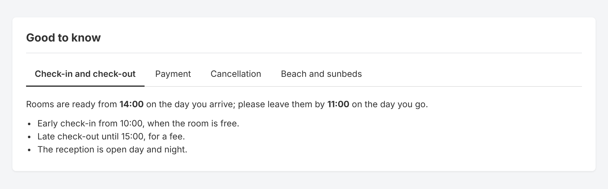
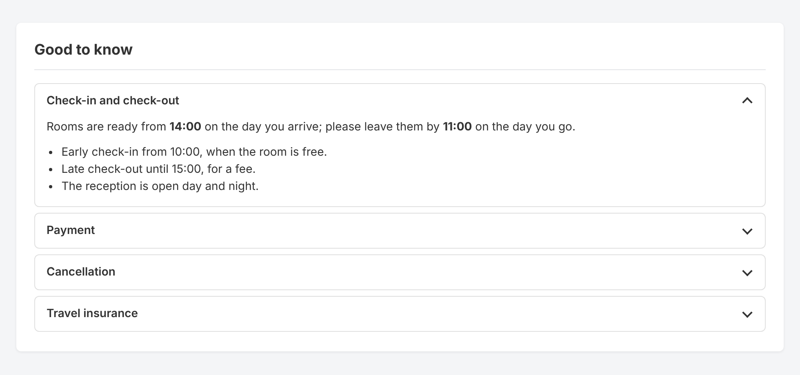
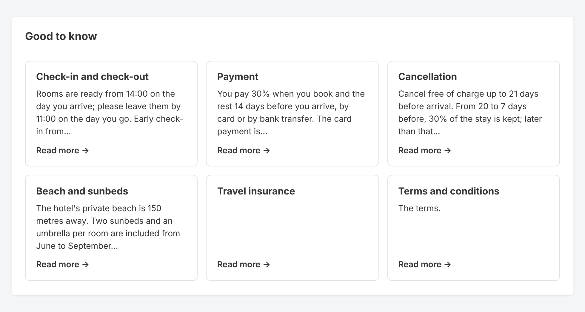
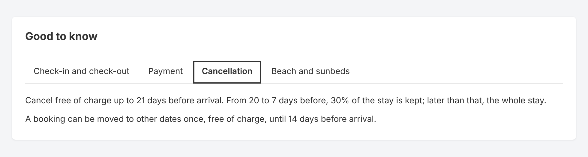
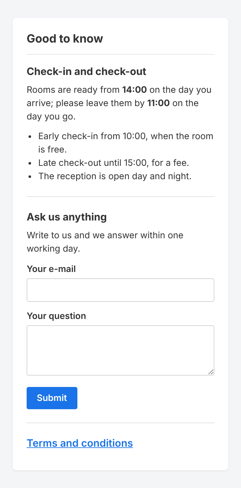
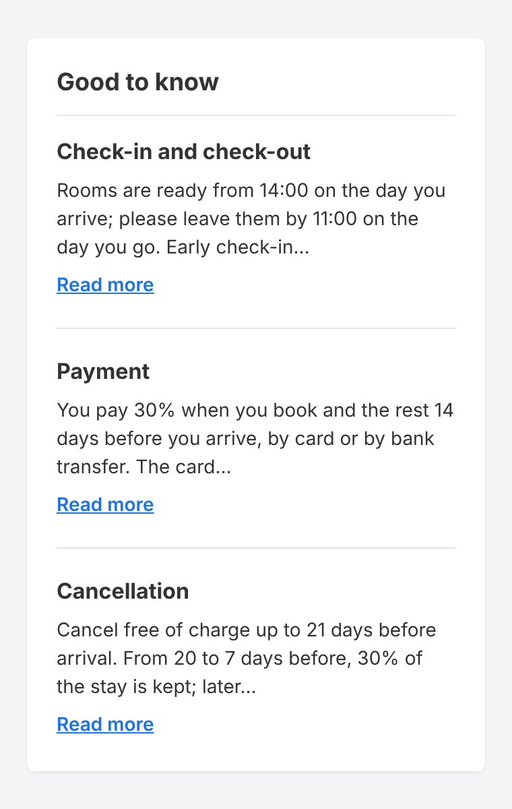
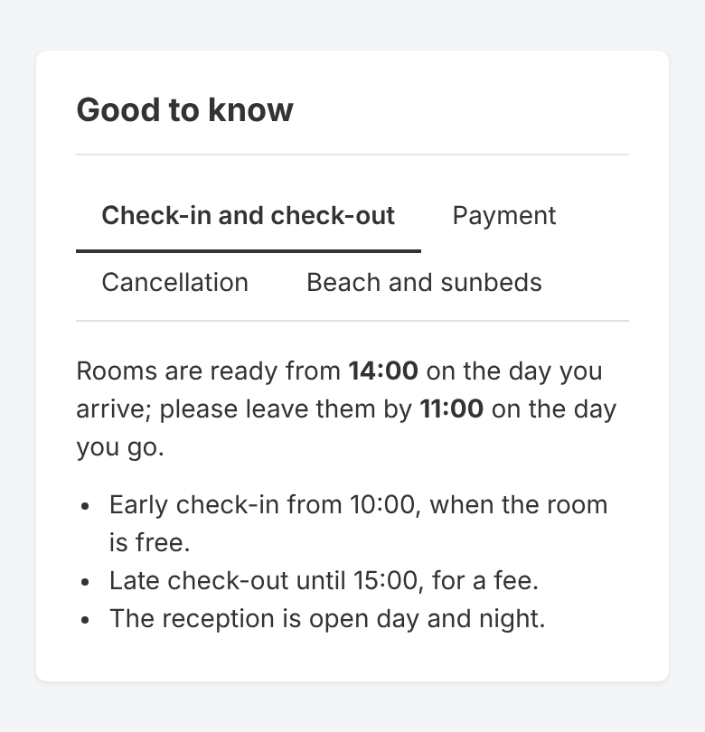
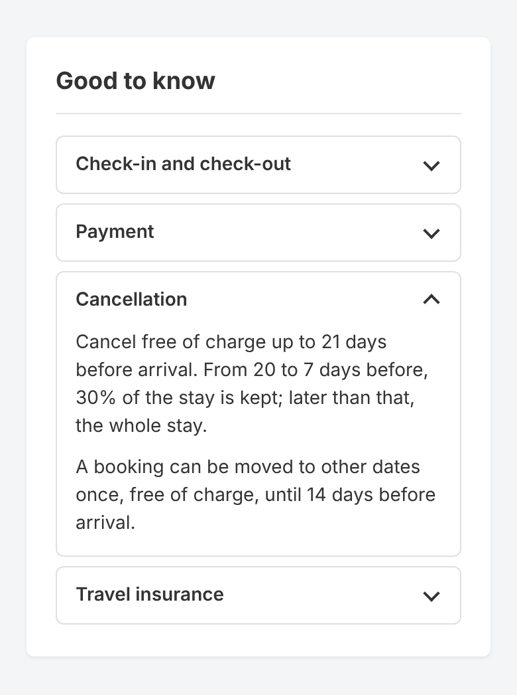
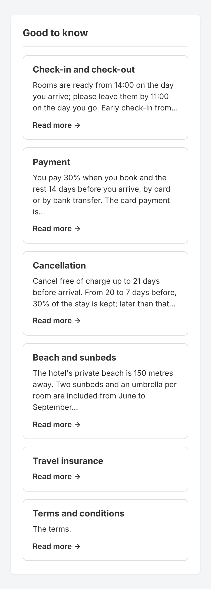
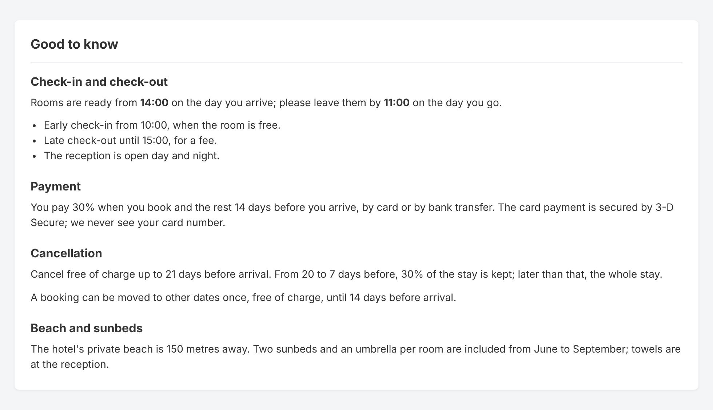

# `addon-euph-pages-in-blocks/` — Pages in blocks

CS-Cart add-on **`euph_pages_in_blocks`** 1.0.1, by VacanteLitoral.ro
(office@VacanteLitoral.ro, https://vacantelitoral.ro).

Shows the content of CMS pages — text pages, forms and polls — inside the blocks of
the storefront layouts. Pick the pages in a **Page content** block and choose how
they show: **one under another**, as **tabs**, as an **accordion** or as **cards**.
Typical uses: cancellation and payment policies in tabs on every hotel page, a
questions-and-answers accordion, a contact form in a sidebar, teaser cards that
link to longer pages.

- **Editions:** CS-Cart, CS-Cart Ultimate, Multi-Vendor, Multi-Vendor Plus/Ultimate, **4.21.2 or newer**.
- **PHP:** **8.3** or newer.
- **Dependencies:** none. No licence key. Forms need the core *Form builder* add-on, polls the *Polls* add-on.
- **Languages:** English and Romanian.
- **Footprint:** no tables, no PHP hooks, no core template overridden. The core *Pages* block is left as it is.
- **Files:** 26 in the zip. The code is `addon.xml` and two PHP files, `func.php` and the block schema (see [Code layout](#code-layout)).

## Screens

Rendered by Smarty 5 from the add-on's own templates, stylesheet and script. Only the
store around the block (fonts, box title, buttons, the sample form's fields) imitates
the Responsive theme. Sources: [`docs/screens/src/`](docs/screens/src/).

<table>
<tr>
<td><a href="docs/screens/tabs.png"></a><br>Tabs</td>
<td><a href="docs/screens/accordion.png"></a><br>Accordion, first section open</td>
</tr>
<tr>
<td><a href="docs/screens/cards.png"></a><br>Cards, three per row</td>
<td><a href="docs/screens/tabs-keyboard.png"></a><br>Tabs moved with the arrow keys (focus ring)</td>
</tr>
<tr>
<td><a href="docs/screens/stacked.png"></a> <a href="docs/screens/stacked-excerpt.png"></a><br>One under another, in a sidebar: a text page, a form, a popup page; excerpts</td>
<td><a href="docs/screens/tabs-phone.png"></a> <a href="docs/screens/accordion-phone.png"></a> <a href="docs/screens/cards-phone.png"></a><br>Phones: tabs wrap, sections, one card per row</td>
</tr>
<tr>
<td colspan="2"><a href="docs/screens/tabs-no-script.png"></a><br>Tabs without JavaScript: the pages read in order, each with its name</td>
</tr>
</table>

## How to use

1. **Design → Layouts**, then the layout and the location (tab) where the content should appear: the product page, the homepage, a category, every page (the default location).
2. In a grid: **Add block → Create new block → Page content**, and give the block a name.
3. **Content** tab: pick the pages. They show in the order they are picked. The picker is the core Pages block's own.
4. **Settings** tab: choose the template and its options (below). The block's wrapper and user class work as for any block.

The add-on's *Settings* tab (Add-ons → Pages in blocks) repeats these steps and links to Layouts.

### Templates and their settings

| Template | What it shows | Settings (default first) |
|---|---|---|
| **One under another** | Each page with its name and its content. | *Show the page names* (on) · *Separator lines between pages* (on) · *Show*: the whole page / an excerpt with a "Read more" link · *Excerpt length, in characters* (200; 40 to 2000) |
| **Tabs** | A tab per page, its content in the panel. | — |
| **Accordion** | A section per page that opens on its name, as in a list of questions. | *Open the first section* (off) · *Keep only one section open* (on) |
| **Cards** | A card per page: its name, the start of its text, "Read more". The whole card is the link. | *Cards per row on wide screens* (3; 2 to 4) · *Excerpt length, in characters* (200) |

Cards show one per row on phones and two on tablets, whatever the setting.

### Which pages show

Each page is read the way CS-Cart reads it for the page's own address (`fn_get_page_data()`), so the same rules apply:

- **Status:** *Active* and *Hidden* pages show, *Disabled* pages never. Tip: set a page to **Hidden** to use it only as block content — it stays out of the menus and page lists, and the block still shows it.
- **User groups**, **availability period** and, in Ultimate and Multi-Vendor Plus/Ultimate, **storefronts**: a page the visitor may not see is left out. The others keep their order.
- A page with no name in the visitor's language is left out; a block shows at most 50 pages. A block with nothing to show draws nothing.

### What each kind of page becomes

| Page | In the block |
|---|---|
| Text page (and any other add-on's page type, such as a blog post) | Its text, with the theme's text styles (`ty-wysiwyg-content`). |
| Form (*Form builder*) | The form, drawn by the Form builder through the page's own template hook (`pages:page_content`), as on its own page. Sending it works as on that page: the Form builder handles it and shows its confirmation. |
| Poll (*Polls*) | The poll, drawn by the Polls add-on, as on its own page. |
| Link page | A link to its address; in a new window when the page says so (`rel="noopener"`, with a hint for screen readers). A link to a `javascript:` or `data:` address is never printed. |
| Page set to open in a popup | Its name opens it in CS-Cart's dialog. |

Forms and polls also get the `pages:page_extra` hook, as on their page. Text pages do not, so what add-ons draw under a page's text on its own view (such as comments or share buttons) stays out of the block.

### Behaviour and accessibility

- **Tabs** follow the WAI-ARIA tabs pattern: one tab stop, the arrow keys move between tabs (reversed on right-to-left pages), Home and End go to the first and last. The tab row wraps on narrow screens, so every page name stays in sight.
- **Without JavaScript**, tabs read as the pages one under another, each with its name. The roles are added by the script that makes them work.
- **Accordion** sections are native `<details>`: they open by mouse, touch and keyboard with no script. With *Keep only one section open* they share a name, so the browser closes the others (the script does it in browsers that do not).
- **Links to a tab or a section:** an address ending in `#euph-pib-<placement>-p<page id>` opens that tab or section (also the id of anything inside it). The ids are stable: copy one from the page source.
- **Printing** shows every tab panel and section, then puts them back.
- Motion is off for visitors who ask for reduced motion. Focus rings are visible; colours come from the theme.
- **Caching:** the block is never cached, so a form's confirmation or a poll's result is seen only by the visitor who sent it.

### Styling

The block uses the theme's own colours (`currentColor`, inherited fonts) and neutral borders, so it fits any colour preset. One custom property tunes the accent of the selected tab and the focus rings:

```css
.euph-pib { --euph-pib-accent: #c8102e; }
```

Classes for a theme's custom CSS: `euph-pib` (the block, plus `euph-pib--stacked|tabs|accordion|cards`), `euph-pib__item` and `euph-pib__item--text|link|form|poll` (each page), `euph-pib__title`, `euph-pib__tab`, `euph-pib__panel`, `euph-pib__section`, `euph-pib__summary`, `euph-pib__card`, `euph-pib__excerpt`, `euph-pib__more`.

## Install, disable, uninstall

**Install** (upload the zip as a manual add-on installation, or copy its folders to the store root): nothing is created in the database apart from what CS-Cart keeps for every add-on (its settings section and texts). The *Page content* block type appears in **Add block**.

- Zip: `php scripts/package-addons.php euph_pages_in_blocks` writes `dist/euph_pages_in_blocks-1.0.1.zip`.
- Deploy to a store: **Actions → Deploy → Run workflow** (the add-on is in the form's default list; tick *go* to deploy for real), or by hand `bash scripts/deploy-addons.sh user@host:/path/to/cscart --addons euph_pages_in_blocks` (dry run; add `--go`). Then install it in **Add-ons → Downloaded add-ons**.

**Themes:** the storefront files ship for `responsive` and `nova_theme` (identical copies). The block manager offers a block type only where its templates are in the store's theme itself. For another theme, copy `design/themes/responsive/templates/addons/euph_pages_in_blocks` and `design/themes/responsive/css/addons/euph_pages_in_blocks` into that theme.

**Disable:** nothing is deleted; the blocks and their settings stay in the layouts and work again once the add-on is enabled.

**Uninstall:** takes the *Page content* blocks out of every layout (their contents, names, placements and per-page statuses). The pages themselves are not touched. CS-Cart removes the add-on's settings and texts.

### Replacing another "page content in blocks" add-on

Both can stay installed during the switch: this add-on adds its own block type and leaves the core Pages block and its templates alone.

1. Install this add-on.
2. Where an old block shows page content, add a *Page content* block with the same pages and the template that fits.
3. Check the storefront, then remove the old blocks and uninstall the old add-on.

## For developers

### How it plugs into CS-Cart

- **Two PHP files, no classes.** CS-Cart reads `addon.xml`, loads `func.php` for the active add-on (every function of the add-on is there) and includes `schemas/block_manager/blocks.post.php` when it builds the block manager schema. No `init.php`, no autoloader.
- **Block type** `euph_page_content` in `schemas/block_manager/blocks.post.php`: its content is the core Pages block's manual filling, served by the add-on's items function; four templates, each with its settings. No `cache` key. The file needs nothing from `func.php`, and builds the type in a closure so that none of its variables leaks into `fn_get_schema()`, which includes it.
- **Items:** `fn_euph_pages_in_blocks_get_pages($params)` reads `item_ids` with `fn_get_page_data()` and returns `[pages, params]`, as `fn_get_pages()` does.
- **View:** each template calls `{$pib = fn_euph_pages_in_blocks_view($items, $block, "tabs")}`: ids, links, kinds, excerpts and settings are worked out in PHP; the templates only print.
- **Template hooks used:** `pages:page_content`, `pages:page_extra` (as `views/pages/view.tpl`), `index:scripts`, `index:styles`.
- **Smarty 5** (CS-Cart 4.19+): the templates use only Smarty's own modifiers and CS-Cart's `__()` and `fn_url`; no PHP function as a modifier.
- **Stylesheet:** plain CSS in a `.less` file. CS-Cart compiles the storefront styles with lessphp, which mangles `calc()` and slashes and trips on custom-property declarations, so there are none.
- **Script:** `js/addons/euph_pages_in_blocks/func.js`, plain ES5 syntax (CS-Cart bundles the storefront scripts). It sets up blocks on load and on CS-Cart's `ce.commoninit`, once each, and exposes `window.EuphPagesInBlocks` (`init`, `openFromHash`).

| Function | Does |
|---|---|
| `fn_euph_pages_in_blocks_get_pages($params)` | Items function of the block type. |
| `fn_euph_pages_in_blocks_view($items, $block, $layout)` | The template's view: an empty array when there is nothing to show. |
| `fn_euph_pages_in_blocks_uninstall()` | Removes the blocks of the type (addon.xml uninstall function). |

The other functions of `func.php` are their parts: `_present()` (the view, given the block ids already used in the page), `_settings()`, `_item()`, `_excerpt()`, `_text()`, `_table_exists()`, and `_int()`, `_string()`, `_flag()`, `_map()`, `_ids()`, which narrow the untyped values CS-Cart hands over.

### Code layout

```
addon-euph-pages-in-blocks/
├── app/addons/euph_pages_in_blocks/
│   ├── addon.xml              id, compatibility, the "How to use" setting, uninstall function
│   ├── func.php               all the PHP: the items and view functions, uninstall
│   ├── schemas/block_manager/ the Page content block type (blocks.post.php)
│   └── tests/                 PHPUnit: unit tests, and the templates rendered by Smarty 5 (Support\TemplateHarness)
├── design/backend/…           the Settings tab panel, the icon
├── design/themes/responsive/… templates (4 layouts, 2 components, 2 asset hooks) and the stylesheet
├── design/themes/nova_theme/… the same files (composer mirror keeps them identical)
├── js/addons/euph_pages_in_blocks/func.js
├── var/langs/{en,ro}/addons/euph_pages_in_blocks.po
└── docs/screens/              the screens above and their sources (not packaged)
```

The zip holds 26 files: the 3 of `app/`, 2 in `design/backend`, 9 per theme, the script and the two language packs. `tests/`, the Composer and PHPUnit files and `docs/` stay out of it.

### Checks

All of them run in CI (`.github/workflows/ci.yml`):

| Check | Command |
|---|---|
| PHPUnit, with the templates rendered by Smarty 5 (CI also measures coverage, floor 97 %) | `composer test:euph-pib` (after `composer install` in `app/addons/euph_pages_in_blocks`) |
| PHPStan level 10, strict | `composer stan` |
| Code style (imports and whitespace: the procedural config) | `composer fix:proc:dry` |
| Rector | `composer rector:dry` |
| nova_theme copies identical (travel_core's ThemeMirrorTest) | `php scripts/mirror-themes.php --check` (`composer mirror` syncs) |
| ESLint | `npx eslint addon-euph-pages-in-blocks/js` |
| Vitest (jsdom) | `npx vitest run tests/js/euph-pages-in-blocks.test.mjs` |

**Screens:** `php docs/screens/src/render.php <out dir> <compiled css>` draws the pages, then `node docs/screens/src/render.mjs <out dir> docs/screens` takes the screenshots (needs Playwright with Chromium; set `PLAYWRIGHT_MODULE` when it is installed globally).

## Before going live: test on a copy of the store

The code is checked by static analysis and tests, and the templates are rendered by
Smarty 5, but it has not run inside a CS-Cart store yet: the local Docker store
(`docker/fullstore`, CS-Cart 4.21.2) is the place to start. On a staging copy, with
the store's own theme (`nova_theme` in production):

1. **Install.** *Pages in blocks* is in Add-ons, with its icon; its Settings tab shows the steps.
2. **Add a Page content block** to the product page layout: it is in *Create new block*, the picker lists the pages, and the four templates are in the Template list, each with its settings.
3. **Text pages:** one under another, then each template. Check a page set to *Hidden* (shown), *Disabled* (not shown) and one reserved for a user group (shown only to it).
4. **Tabs:** click and use the arrow keys; open the product page with `#<panel id>` in the address; check a phone; print.
5. **Accordion:** *Open the first section* and *Keep only one section open*, on and off.
6. **Cards:** 2, 3 and 4 per row; a link page and a popup page in a card.
7. **Form** (Form builder on): fill it in from the block and send it; the confirmation shows; reload the product page: the form is back for the next visitor.
8. **Poll** (Polls on): vote from the block.
9. **A popup page** opens in the dialog; **a link page** opens its address (in a new window if set).
10. **Ultimate / MV Plus/Ultimate:** a page of another storefront is not shown.
11. **Disable** the add-on: the storefront still works and the blocks no longer show. **Re-enable:** they are back. **Uninstall** on the copy: the blocks are gone from the layouts, the pages are still there.

## Pe scurt (RO)

Add-onul **Pagini în blocuri** afișează conținutul paginilor (text, formulare din
*Form builder*, sondaje din *Polls*) în blocurile din layout. În **Design → Layouts**
adaugi un bloc nou de tipul **Conținut pagini**, alegi paginile în fila *Conținut* și
șablonul în fila *Setări*: **Una sub alta**, **File (tab-uri)**, **Acordeon** sau
**Carduri**. Apar doar paginile pe care vizitatorul le poate vedea; o pagină pusă pe
*Ascuns* nu apare în meniuri, dar blocul o afișează. Funcționează pe CS-Cart,
CS-Cart Ultimate, Multi-Vendor și Multi-Vendor Plus/Ultimate 4.21.2+, cu PHP 8.3+,
în limbile engleză și română. Nu creează tabele și nu modifică șabloanele CS-Cart; la
dezinstalare, blocurile „Conținut pagini” sunt scoase din layouturi, paginile rămân.

## Changelog

**1.0.1** (2026-10-17) — The same block in fewer files: all the PHP is in `func.php` and the block schema; `init.php`, `functions/` and `src/` are gone, and so is the `popup_target.tpl` component (its one line is in each layout). Nothing changes in the panel or on the storefront. Updating a store that has 1.0.0: copy the new files over the old ones, then delete `app/addons/euph_pages_in_blocks/init.php`, `…/functions/`, `…/src/` and `design/themes/*/templates/addons/euph_pages_in_blocks/components/popup_target.tpl` (left in place they are never loaded).

**1.0.0** (2026-10-17) — First release: the Page content block type with four templates (one under another, tabs, accordion, cards), English and Romanian.
